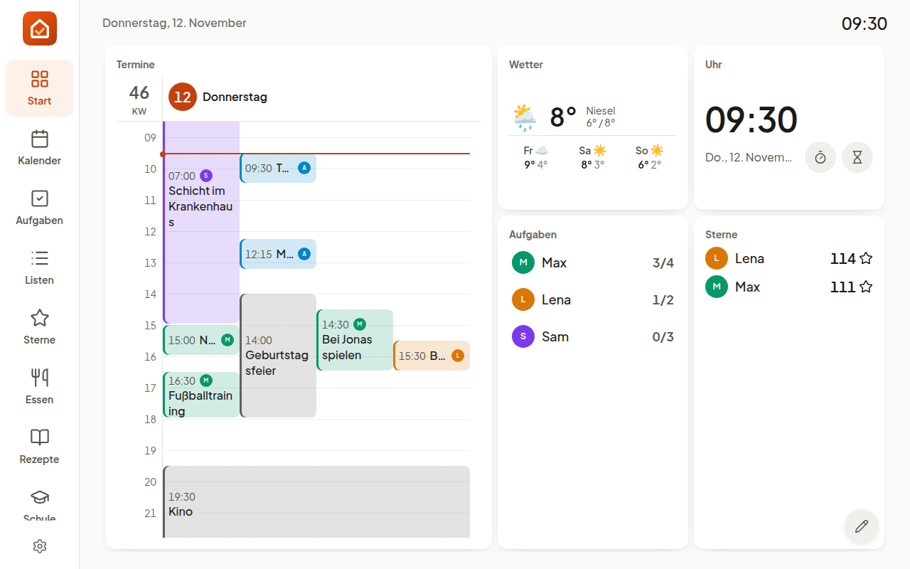
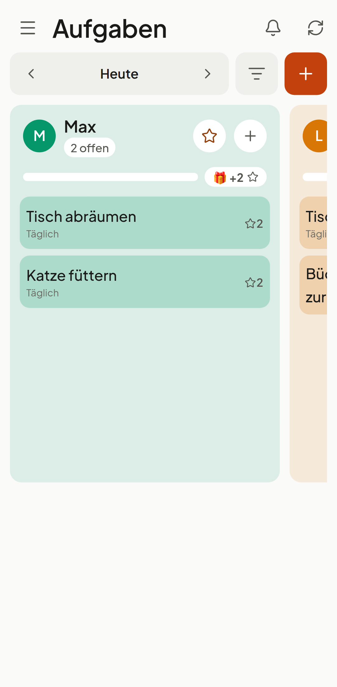
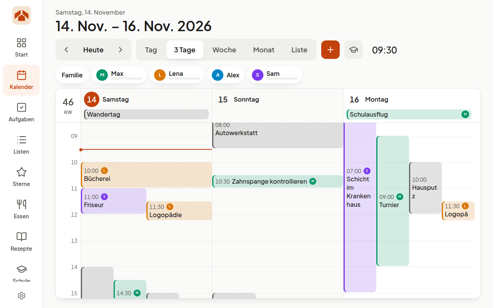
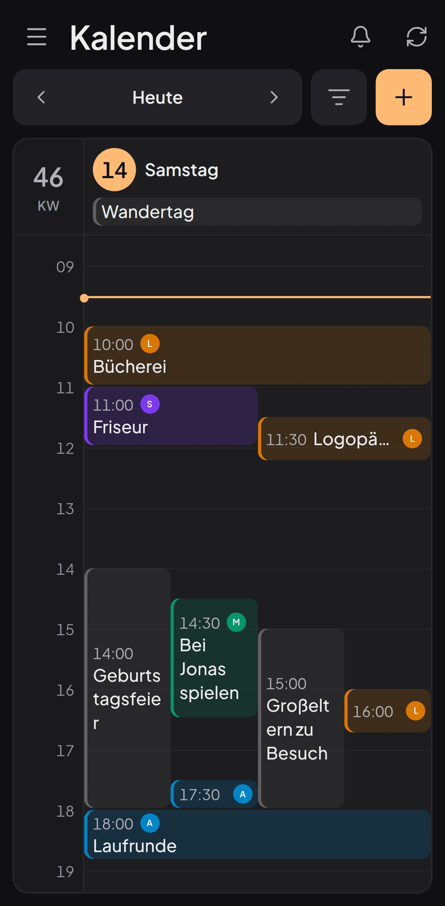

# Tagwerk

*English version: [`README.md`](README.md)*

Selbst gehosteter Familienkalender für ein wandmontiertes Tablet und die
Handys der Familie — Kalender, Aufgaben mit Sternen und Belohnungen, Listen,
Essensplan und Rezeptbuch, Stundenplan, Bilderrahmen und Wetter, für mehrere
Haushalte auf einem Server.

Google-Kalender bleibt die führende Quelle: Was dort steht, steht an der Wand,
und was an der Wand entsteht, landet dort. Kinder haben keine Google-Konten und
brauchen keine.

| An der Wand | Am Handy |
|---|---|
|  |  |
|  |  |

Mehr in [`docs/screenshots/`](docs/screenshots/), hell und dunkel.

## Auf einem Server installieren

Es braucht nur Docker mit Compose, keinen Checkout. In einem leeren Ordner:

```bash
cat > compose.yaml <<'EOF'
services:
  app:
    image: ghcr.io/tagwerk-family/tagwerk:latest
    restart: unless-stopped
    depends_on: { db: { condition: service_healthy } }
    environment:
      APP_NAME: Tagwerk
      APP_URL: https://${TAGWERK_HOST}
      APP_KEY: ${APP_KEY}
      LOG_CHANNEL: stderr
      DB_CONNECTION: pgsql
      DB_HOST: db
      DB_DATABASE: tagwerk
      DB_USERNAME: tagwerk
      DB_PASSWORD: ${DB_PASSWORD}
      SESSION_DRIVER: database
      SESSION_ENCRYPT: "true"
      SESSION_SECURE_COOKIE: "true"
      TAGWERK_TRUSTED_PROXIES: 10.0.0.0/8,172.16.0.0/12,192.168.0.0/16
      TAGWERK_MAIL: "off"
    volumes: [storage:/var/www/html/storage]
  db:
    image: postgres:16-alpine
    restart: unless-stopped
    environment:
      POSTGRES_DB: tagwerk
      POSTGRES_USER: tagwerk
      POSTGRES_PASSWORD: ${DB_PASSWORD}
    healthcheck:
      test: ["CMD-SHELL", "pg_isready -U tagwerk -d tagwerk"]
      interval: 5s
      retries: 20
    volumes: [db:/var/lib/postgresql/data]
  caddy:
    image: caddy:2-alpine
    restart: unless-stopped
    command: caddy reverse-proxy --from ${TAGWERK_HOST} --to app:8080
    ports: ["80:80", "443:443"]
    volumes: [caddy:/data]
volumes: { storage: {}, db: {}, caddy: {} }
EOF

cat > .env <<EOF
TAGWERK_HOST=tagwerk.example.org
APP_KEY=base64:$(openssl rand -base64 32)
DB_PASSWORD=$(openssl rand -hex 24)
EOF

docker compose up -d
docker compose exec app su-exec www-data php artisan tagwerk:create-operator Admin du@example.org
```

`TAGWERK_HOST` ist der öffentliche Name deines Servers: Ports 80 und 443
müssen ihn erreichen, Caddy holt das HTTPS-Zertifikat selbst. Danach
`https://<host>/admin` öffnen, mit dem Betriebskonto anmelden und den ersten
Haushalt anlegen. Die `.env` gut aufheben: Ohne `APP_KEY` sind die
gespeicherten Zugangsdaten nicht mehr lesbar.

Das Image `ghcr.io/tagwerk-family/tagwerk` läuft auf amd64 und arm64
(Raspberry Pi 4/5); `:latest` ist der neueste Release. So läuft
Tagwerk ohne Mail (Konten bekommen ihr Passwort im Admin) und ohne
Echtzeit. Mail, Plugins, Traefik oder ein Proxy, den du schon betreibst,
Aktualisieren ohne Ausfall, Sicherung und Fehlersuche:
**[`docs/installation.de.md`](docs/installation.de.md)**.

## Schnellstart (Entwicklung)

```bash
ddev start
ddev exec 'cd apps/platform && php artisan migrate:fresh --seed'
ddev launch /admin
```

Der Seeder füllt einen Beispielhaushalt; dessen Eltern melden sich als
`alex@example.test` oder `sam@example.test` mit dem Passwort `password` an.
Einen Betreiber ohne Haushalt, der unter **Betrieb** weitere Haushalte
anlegt, erzeugt
`ddev exec 'cd apps/platform && php artisan tagwerk:create-operator <Name> <E-Mail>'`.

Wand und Handy sind eine App, gebaut und von nginx unter derselben Adresse
wie die Verwaltung ausgeliefert:

| Adresse | Inhalt |
|---|---|
| `https://tagwerk.test/` | App — Wandtablet oder Handy |
| `https://tagwerk.test/admin` | Verwaltung |

```bash
ddev exec 'cd apps/platform/frontend && pnpm install && pnpm build'
```

Ausgeliefert wird der Stand des letzten Builds. Zum Arbeiten an der Oberfläche
gibt es die Entwicklungsserver mit sofortigem Neuladen:

```bash
ddev exec 'cd apps/platform/frontend && pnpm dev'         # https://tagwerk.test:3000
ddev exec 'cd apps/platform && php artisan reverb:start'  # WebSocket, Port 8080
```

Die Umgebung bringt PHP 8.5, PostgreSQL 16 und Valkey mit.

## Tablet anschließen

In der Verwaltung **Geräte → Erstellen**, dann in der Liste **„Kopplungscode“**. Den Code am Tablet eingeben — fertig, es bleibt dauerhaft
angemeldet.

Der ganze Ablauf samt Kiosk-Einstellungen steht in **[`docs/kiosk.de.md`](docs/kiosk.de.md)**.

## Am Handy

Dieselbe App unter derselben Adresse. Die Startseite bietet zwei Wege: ein
Wandtablet mit Code koppeln oder sich am Handy mit einem persönlichen Konto
anmelden. Die Anordnung folgt dem Bildschirm, nicht dem Weg hinein: schmal
liegen die Bereiche in einem Menü, das von links hereinfährt, breit in der
Leiste. Das Tablet behält Eltern-PIN und Ruhemodus, das Konto bekommt genau
die Rechte seiner Person — Termine, Aufgaben, Listen, Essen, Rezepte und
Belohnungswünsche gehen dort wie an der Wand. Jedes Tablet und jedes Konto
hat sein eigenes Dashboard, angeordnet am Tablet oder Computer; am Handy
stehen die Kacheln untereinander. Eltern erreichen die Verwaltung über das Menü (**Verwaltung**), ohne
sich noch einmal anzumelden; **Zur App** führt zurück. Ein Browser mit
beidem bleibt das Tablet. Im Browser über **Zum Startbildschirm**
installieren — solange das nicht passiert ist, bietet ein Band unten das
Installieren an („Später“ blendet es für sieben Tage aus).

Benachrichtigungen brauchen ein VAPID-Schlüsselpaar. Einmalig erzeugen und in
`apps/platform/.env` eintragen:

```bash
ddev exec 'cd apps/platform && php artisan tagwerk:vapid-keys'
```

Ein Wechsel des öffentlichen Schlüssels macht alle bestehenden Anmeldungen
ungültig — jeder Browser müsste sich neu anmelden. Ohne Schlüssel läuft die App
vollständig, nur ohne Benachrichtigungen.

## Echtzeit

Reverb meldet Änderungen an alle offenen Geräte — abgehakte Aufgaben, neue
Einkaufsartikel, gebuchte Punkte erscheinen ohne Neuladen. Die Meldung trägt
nur den Namen des betroffenen Bereichs; geladen wird mit demselben Abruf wie
sonst auch.

```bash
ddev exec 'cd apps/platform && php artisan reverb:start'
```

Die Schlüssel stehen in `apps/platform/.env` (`REVERB_APP_*`); `REVERB_HOST`,
`_PORT` und `_SCHEME` sind die Sicht des Browsers, `REVERB_SERVER_*` die des
Servers. Läuft Reverb nicht, bleibt alles bedienbar — die Oberflächen fallen
auf den Abruf alle fünf Minuten zurück. Im Betrieb gehört der Prozess unter
einen Supervisor.

## Helles und dunkles Thema

Einzustellen in der Verwaltung beim Haushalt: entweder feste Zeiten oder der
Sonnenstand. Der Sonnenstand nimmt den Ort aus der Adresse des Haushalts,
dazu wahlweise je einen Versatz für Aufgang und Untergang in Minuten. Negativ
heißt früher, positiv später. Ohne Adresse gelten die festen Zeiten.

Dauerhaft hell oder dunkel stellt man an der Wand über „Dieses Gerät“ unten in der
Seitenleiste (gilt für dieses Tablet), am Handy in den Einstellungen und in
der Verwaltung über den Schalter in der Kopfleiste (beides gilt für das eigene
Konto).

## Sprache

Tagwerk spricht Deutsch und Englisch. Der Haushalt legt in der Verwaltung die
Vorgabe fest; jede und jeder wählt die eigene im Profil der Verwaltung oder in
den Einstellungen am Handy, jedes Wandtablet im Geräteformular. Die Texte
liegen in `apps/platform/lang/de.json` (Backend) und
`apps/platform/frontend/packages/shared/i18n/locales/` (Wand und Handy).

Weitere Sprachen kommen als Pakete. Ein Sprachpaket wird wie jedes Plugin
installiert (`TAGWERK_PLUGINS`) und steht danach in jeder Sprachauswahl. Was
ein Paket noch nicht übersetzt, erscheint auf Englisch; Betrieb → Plugins
zeigt, was fehlt. Selbst eines schreiben:
[`docs/plugins.md`](docs/plugins.md#language-packs).

## Google-Kalender verbinden

Braucht ein Google-Cloud-Projekt mit aktivierter Calendar API und einen
OAuth-Client. In `apps/platform/.env`:

```
GOOGLE_CLIENT_ID=
GOOGLE_CLIENT_SECRET=
```

Die Weiterleitungs-URI im Cloud-Projekt muss auf
`/auth/calendar/google/callback` unter der eigenen Adresse zeigen. Danach in
der Verwaltung unter **Verbindungen** verbinden.

Ohne verbundenes Konto ist Tagwerk vollständig benutzbar: Jeder Haushalt hat
einen eingebauten Kalender, dessen Termine nur hier liegen.

## Mit Google anmelden

Das Plugin `tagwerk/social-login` bringt „Mit Google anmelden“ in die App und
nach `/admin`. Es meldet nur **bestehende** Konten an: beim ersten Mal über
die E-Mail-Adresse, die Google bestätigt, danach über Googles eigene Kennung.
Haushalte und Konten legen weiterhin Betreiber und Einladung an; eine offene
Einladung gilt damit als angenommen. Ein zweiter Faktor wird weiterhin
abgefragt.

1. In der [Google Cloud Console](https://console.cloud.google.com/) ein
   eigenes Projekt anlegen, z. B. „Tagwerk Login“. Mit nur `openid`, `email`
   und `profile` darf es ohne Googles Prüfung in Produktion — das Projekt des
   Kalenders bliebe im Testmodus.
2. **Google Auth Platform → Branding**: App-Name, Support-Adresse, die eigene
   Domain als autorisierte Domain. Kein Logo, das löst eine Prüfung aus.
3. **Data Access**: nur `openid`, `…/auth/userinfo.email` und
   `…/auth/userinfo.profile` hinzufügen.
4. **Audience**: Extern, dann **App veröffentlichen**.
5. **Clients → Client erstellen**: Webanwendung, autorisierte
   Weiterleitungs-URI `https://<deine-domain>/social/google/callback`.
6. Den Client in `deploy/.env` eintragen und ausrollen:

   ```
   SOCIAL_GOOGLE_CLIENT_ID=
   SOCIAL_GOOGLE_CLIENT_SECRET=
   ```

7. In `/admin` unter **Betrieb → Erweiterungen** „Anmeldung über Google & Co.“
   einschalten.

Google nimmt als Weiterleitung nur öffentliche Domains und `localhost`, nicht
`tagwerk.test`; lokal stehen die PHPUnit-Tests für Google. Weitere Anbieter
(Microsoft, Apple, Keycloak, …) sind eine Socialite-Anbieterklasse in
`plugins/social-login/config/social-login.php`.

## Plugins und Schnittstellen

Das Image bringt kein Plugin eingeschaltet mit. Der Betreiber nennt die
gewünschten in `TAGWERK_PLUGINS` in `deploy/.env`, etwa
`TAGWERK_PLUGINS="tagwerk/caldav tagwerk/two-factor"`; der Container
installiert sie beim Start (die von Tagwerk in der Version des Images,
andere von Packagist). Jeder Haushalt schaltet ihre Bereiche dann unter
Haushalt → Bereiche ein und aus. Was den Haushalt für andere Programme
öffnet – API-Zugang, Kalender-Abos, Webhooks, MCP – ist aus, bis ein
Elternteil es unter Haushalt → Schnittstellen einschaltet. Die von Tagwerk:

| Paket | Was es tut | Wo es eingerichtet wird |
|---|---|---|
| `tagwerk/caldav` | Kalender aus Nextcloud, iCloud, mailbox.org oder jedem CalDAV-Server, in beide Richtungen | Verbindungen → CalDAV |
| `tagwerk/ics-feed` | Eine geheime Kalenderadresse je Familie oder Person für andere Kalender-Apps | Integrationen → Kalender-Abos |
| `tagwerk/webhooks` | Signierte POSTs bei gewählten Ereignissen, etwa an Home Assistant | Integrationen → Webhooks |
| `tagwerk/mcp` | `/mcp` für KI-Assistenten (Model Context Protocol) | ein API-Token, siehe unten |
| `tagwerk/openapi` | Die API beschrieben unter `/api/openapi.json` | — |
| `tagwerk/webdav-backup` | Nächtliche Sicherung von Datenbank und Uploads in einen WebDAV-Ordner | Betrieb → Erweiterungen |
| `tagwerk/bring` | Einkaufslisten mit Bring in beide Richtungen | Verbindungen → Bring |
| `tagwerk/kochwiki` | Rezepte aus dem Koch-Wiki, einmal je Server gespiegelt | Verbindungen → Koch-Wiki |
| `tagwerk/two-factor` | Authenticator-App als zweiter Faktor | Betrieb → Erweiterungen |
| `tagwerk/social-login` | Anmelden mit Google (und anderen Socialite-Anbietern) | Betrieb → Erweiterungen |

**API-Tokens** (Integrationen → API-Zugang) lassen Skripte und Assistenten
herein: nur lesend oder mit Schreiben, für einen Haushalt, nie mehr, als das
Konto selbst darf. Ein MCP-Client verbindet sich mit `https://<host>/mcp`
und dem Header `Authorization: Bearer <token>`. CalDAV-Server und
Webhook-Ziele müssen aus dem Internet erreichbar sein; Adressen im Heimnetz
werden abgelehnt. Ein Plugin schreiben: [`docs/plugins.md`](docs/plugins.md)
(auf Englisch; `php artisan tagwerk:make-plugin acme/name --widget` legt ein
lauffähiges Grundgerüst an).

**Eigenes Aussehen oder eigene Oberfläche.** Ein Design-Paket ändert
Farben, Schrift und Ecken (`tagwerk:make-plugin acme/name --theme`); der
Haushalt wählt es, ein Tablet kann beim Tagwerk-eigenen bleiben. Eine ganz
andere Oberfläche — etwa für eine E-Ink-Wand — ersetzt die App unter `/`:
gebaut auf [`@tagwerk/client`](apps/platform/frontend/packages/client),
begonnen mit der Frontend-Vorlage, gewählt mit `TAGWERK_FRONTEND`.
Anleitung: [`docs/frontends.md`](docs/frontends.md) (auf Englisch).

## Tests

```bash
ddev exec 'cd apps/platform && php artisan test'                      # PHPUnit
ddev exec 'cd apps/platform/frontend && pnpm test'                    # Vitest
cd apps/platform/frontend/packages/e2e && pnpm run e2e                # Playwright, vom Wirt
```

GitHub Actions führt PHPUnit, Pint, Vitest und die Typprüfung bei jedem Push
aus; ein Release-Tag (`v1.2.3`) baut und veröffentlicht das Image.

Backend-Tests laufen gegen eine echte PostgreSQL-Datenbank (`tagwerk_test`), nie
gegen SQLite. Playwright läuft bewusst vom Wirt statt aus dem Container und
prüft, was nginx unter `https://tagwerk.test` ausliefert — vorher also
`pnpm build`. Begründung in `AGENTS.md`.

## Dokumentation

| Datei | Inhalt |
|---|---|
| [`docs/installation.de.md`](docs/installation.de.md) | Server installieren, aktualisieren und sichern |
| [`docs/kiosk.de.md`](docs/kiosk.de.md) | Tablet koppeln und Kiosk-Betrieb |
| [`CONTRIBUTING.md`](CONTRIBUTING.md) | Mitarbeiten, und die Rechte an einem Beitrag (englisch) |
| [`SECURITY.md`](SECURITY.md) | Sicherheitslücken melden (englisch) |
| [`CHANGELOG.md`](CHANGELOG.md) | Was sich in welcher Version geändert hat, und warum |
| [`AGENTS.md`](AGENTS.md) | Konventionen, Fallstricke, Befehle |
| [`docs/architecture.md`](docs/architecture.md) | Das Design und seine Gründe (englisch) |

## Stand

**Version 0.2.0** (2026-11-08) — alles, was eine Familie im Alltag braucht,
ist da, an der Wand wie am Handy:

- **Kalender** — eingebaut oder Google in beide Richtungen; Tag, drei Tage,
  Woche, Monat und Liste, eine Spalte je Person, Schulband.
- **Aufgaben und Routinen** — reihum, nach Tageszeit, je Kind, in den
  Ferien pausiert; antippen, bestätigen, dann „Wer war das?“; vier Wochen
  zum Zurückschauen.
- **Sterne und Belohnungen** — Tagesbonus, Extrasterne mit Grund,
  Abzeichen, Belohnungswünsche; die Eltern-PIN schützt die Wand.
- **Statistik** für Eltern — wer welche Aufgabe wie oft macht, eigene
  Aufgaben erledigt, Wochentage, Sterne; in der Verwaltung, der App, über
  die API und für einen Assistenten, mit CSV-Download.
- **Listen** — Einkaufslisten in Tagwerk, mit Bring in beide Richtungen
  abgeglichen oder an Google Tasks geschickt.
- **Essen und Rezepte** — ein Wochenplan, Portionen danach, wer mitisst, das
  eigene Rezeptbuch (getippt, von einem Link, fotografiert, als Sammlung),
  Koch-Wiki und Tandoor als Quellen, Zutaten zusammengezählt auf die Liste.
- **Stundenplan** je Kind mit Läutraster, Ferien und Entfall.
- **Dashboard** je Tablet und je Konto, Wetter, Ruhemodus mit Abdunkeln.
- **Bilderrahmen** aus Uploads und Ordnern, in fünf Darstellungen je Gerät
  (Einzelbild, Duo, Mosaik, neben Uhr und Terminen, Rückblicke), eine
  Mediathek mit Favoriten und Alben, und ein Foto vom Handy direkt an die
  Wand.
- **Eine App** für Wand und Handy, mit Push, Echtzeit, Deutsch und Englisch,
  hell und dunkel.
- **Betrieb** — mehrere Haushalte auf einem Server, Betreiber mit
  Support-Zugang, Rechte je Person, zweiter Faktor und Anmeldung über
  Google & Co. als Erweiterungen, Betrieb ohne Mail, Content Security Policy, Sicherung
  und Ausrollen ohne Unterbrechung.

Was noch offen ist, steht im [Changelog](CHANGELOG.md) unter „Known
limitations“ („Bekannte Einschränkungen“).

## Lizenz

Tagwerk ist **quelloffen einsehbar** unter der
[PolyForm Shield License 1.0.0](LICENSE). Familien, Schulen, Vereine,
Kitas und Betriebe dürfen es für sich selbst betreiben, untersuchen,
verändern und weitergeben — auch für Verwandte und Freunde, die sie selbst
einladen. Allen anderen anbieten — als gehosteten Dienst oder als Produkt,
das mit Tagwerk konkurriert — darf nur der Lizenzgeber, Andreas Pointner,
**auch gratis nicht**; das Ende der [`LICENSE`](LICENSE) hält das fest. Für eine kommerzielle Lizenz ein
Issue eröffnen oder an office@copex.io schreiben.

Jedes Paket bringt seine eigene `LICENSE` mit. Die mitgelieferten Plugins
teilen die Lizenz von Tagwerk; die Plugin-Schnittstelle (`tagwerk/plugin-api`)
und das Beispiel-Plugin (`tagwerk/example-area`) stehen unter MIT — ein
Plugin, das darauf aufbaut, darf unter jeder Lizenz erscheinen, die sein
Autor wählt.
