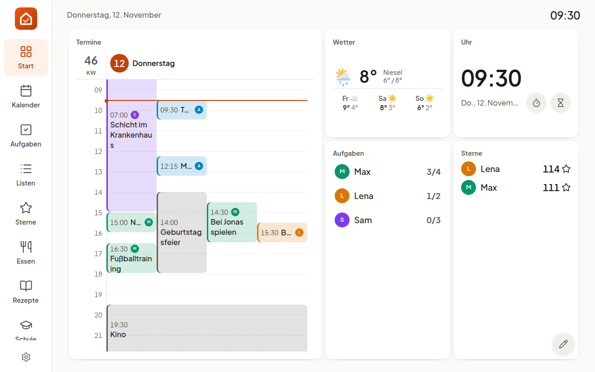
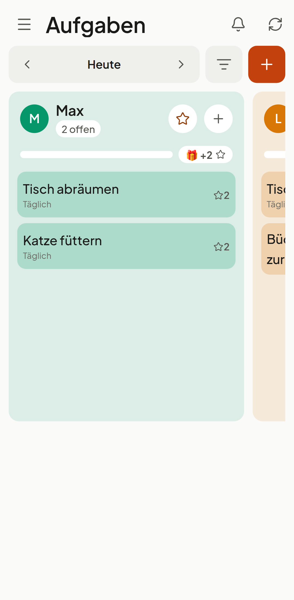
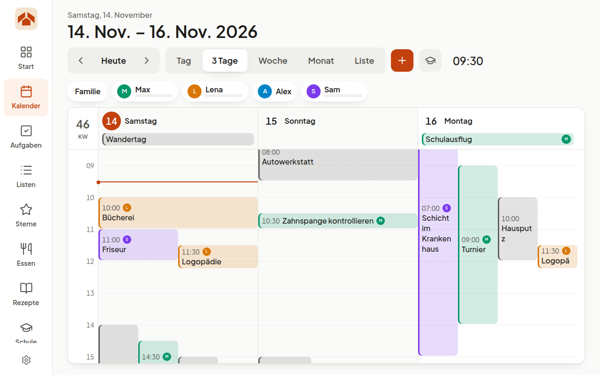
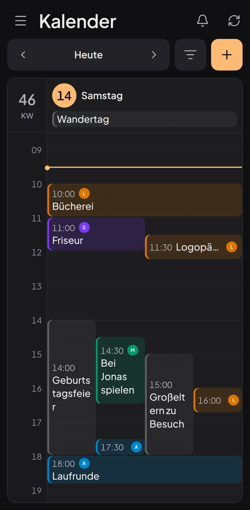

# Fahoba

*Deutsche Fassung: [`README.de.md`](README.de.md)*

**Fa**mily **Ho**me **Bo**ard — where the family's day comes together.

Self-hosted family calendar for a wall-mounted tablet and the family's
phones — calendar, tasks with stars and rewards, lists, meal plan and recipe
book, timetable, photo frame and weather, for several households on one
server.

Google Calendar remains the leading source: what is entered there appears on
the wall, and what is created on the wall ends up there. Children have no
Google accounts and do not need any.

| On the wall | On the phone |
|---|---|
|  |  |
|  |  |

More in [`docs/screenshots/`](docs/screenshots/), light and dark.

## Install on a server

Docker with Compose is all it takes — no checkout. In an empty folder:

```bash
cat > compose.yaml <<'EOF'
services:
  app:
    image: ghcr.io/fahoba/fahoba:latest
    restart: unless-stopped
    depends_on: { db: { condition: service_healthy } }
    environment:
      APP_NAME: Fahoba
      APP_URL: https://${FAHOBA_HOST}
      APP_KEY: ${APP_KEY}
      LOG_CHANNEL: stderr
      DB_CONNECTION: pgsql
      DB_HOST: db
      DB_DATABASE: fahoba
      DB_USERNAME: fahoba
      DB_PASSWORD: ${DB_PASSWORD}
      SESSION_DRIVER: database
      SESSION_ENCRYPT: "true"
      SESSION_SECURE_COOKIE: "true"
      FAHOBA_TRUSTED_PROXIES: 10.0.0.0/8,172.16.0.0/12,192.168.0.0/16
      FAHOBA_MAIL: "off"
    volumes: [storage:/var/www/html/storage]
  db:
    image: postgres:16-alpine
    restart: unless-stopped
    environment:
      POSTGRES_DB: fahoba
      POSTGRES_USER: fahoba
      POSTGRES_PASSWORD: ${DB_PASSWORD}
    healthcheck:
      test: ["CMD-SHELL", "pg_isready -U fahoba -d fahoba"]
      interval: 5s
      retries: 20
    volumes: [db:/var/lib/postgresql/data]
  caddy:
    image: caddy:2-alpine
    restart: unless-stopped
    command: caddy reverse-proxy --from ${FAHOBA_HOST} --to app:8080
    ports: ["80:80", "443:443"]
    volumes: [caddy:/data]
volumes: { storage: {}, db: {}, caddy: {} }
EOF

cat > .env <<EOF
FAHOBA_HOST=fahoba.example.org
APP_KEY=base64:$(openssl rand -base64 32)
DB_PASSWORD=$(openssl rand -hex 24)
EOF

docker compose up -d
docker compose exec app su-exec www-data php artisan fahoba:create-operator Admin you@example.org
```

`FAHOBA_HOST` is your server's public name: ports 80 and 443 must reach
it, and Caddy fetches the HTTPS certificate itself. Then open
`https://<host>/admin`, sign in with the operator and create the first
household. Keep `.env` safe: without `APP_KEY` the stored credentials cannot
be read.

The image `ghcr.io/fahoba/fahoba` runs on amd64 and arm64
(Raspberry Pi 4/5); `:latest` is the newest release. This setup runs
without mail (accounts get a password in the admin) and without realtime.
Mail, plugins, Traefik or a proxy you already run, updates without
downtime, backup and troubleshooting:
**[`docs/installation.md`](docs/installation.md)**.

## Quick start (development)

```bash
ddev start
ddev exec 'cd apps/platform && php artisan migrate:fresh --seed'
ddev launch /admin
```

The seeder fills a demo household; its parents sign in as
`alex@example.test` or `sam@example.test` with the password `password`. An
operator without a household, who creates further households under
**Operations**, comes from
`ddev exec 'cd apps/platform && php artisan fahoba:create-operator <name> <email>'`.

Wall and phone are one app, built and served by nginx under the same address
as the admin:

| Address | Content |
|---|---|
| `https://fahoba.test/` | App — wall tablet or phone |
| `https://fahoba.test/admin` | Admin |

```bash
ddev exec 'cd apps/platform/frontend && pnpm install && pnpm build'
```

What gets served is the state of the last build. For working on the interface
there are development servers with instant reloading:

```bash
ddev exec 'cd apps/platform/frontend && pnpm dev'         # https://fahoba.test:3000
ddev exec 'cd apps/platform && php artisan reverb:start'  # WebSocket, port 8080
```

The environment ships with PHP 8.5, PostgreSQL 16 and Valkey.

## Connecting a tablet

In the admin, go to **Devices → New device** („Geräte → Erstellen“), then in the list choose
**“Pairing code”** („Kopplungscode“). Enter the code on the
tablet — done, it stays signed in permanently.

The full procedure including kiosk settings is in **[`docs/kiosk.md`](docs/kiosk.md)**.

## On the phone

The same app at the same address. The start page offers two ways in: pair a
wall tablet with a code, or sign in on the phone with a personal account. The
layout follows the screen, not the way in: narrow, the areas sit in a menu
sliding in from the left; wide, in the bar. The tablet keeps the parent PIN
and the resting mode; the account gets exactly the rights of its person —
events, tasks, lists, meals, recipes and reward requests are handled there as
at the wall. Each tablet and each account has its own dashboard, arranged on
a tablet or computer; on a phone the tiles stack.
Parents reach the administration from the menu (**Verwaltung**) without
signing in again; **Zur App** leads back. A browser with both stays
the tablet. Install it in the browser via **Add to Home screen** — until then
a band at the bottom offers it (“Later” hides it for seven days).

Notifications need a VAPID key pair. Generate it once and enter it in
`apps/platform/.env`:

```bash
ddev exec 'cd apps/platform && php artisan fahoba:vapid-keys'
```

Changing the public key invalidates all existing subscriptions — every browser
would have to sign in again. Without a key the app works fully, just without
notifications.

## Realtime

Reverb notifies all open devices of changes — ticked-off tasks, new shopping
items and booked points appear without reloading. The message carries only the
name of the affected area; the data is loaded with the same request as usual.

```bash
ddev exec 'cd apps/platform && php artisan reverb:start'
```

The keys are in `apps/platform/.env` (`REVERB_APP_*`); `REVERB_HOST`,
`_PORT` and `_SCHEME` are the browser's view, `REVERB_SERVER_*` the server's.
If Reverb is not running, everything remains usable — the interfaces fall back
to polling every five minutes. In production the process belongs under a
supervisor.

## Light and dark theme

Set in the admin on the household: either fixed times or the position of the
sun. The sun position takes its place from the household's address, plus
optionally an offset for sunrise and sunset in minutes each. Negative means
earlier, positive later. Without an address the fixed times apply.

To keep it permanently light or dark, set it on the wall via “This device”
(„Dieses Gerät“) at the bottom of the sidebar (applies to this tablet), on the phone
in the settings, and in the admin via the switch in the top bar (both apply to
your own account).

## Language

Fahoba speaks German and English. The household sets the default in the
admin; everyone can choose their own under Profile in the admin or in the
phone's settings, and each wall tablet in its device form. Texts live in
`apps/platform/lang/de.json` (backend) and
`apps/platform/frontend/packages/shared/i18n/locales/` (wall and phone).

Further languages come as packages. Install a language pack like any
plugin (`FAHOBA_PLUGINS`) and it appears in every language choice. What a
pack does not translate yet shows in English; Operations → Plugins lists
it. Writing one: [`docs/plugins.md`](docs/plugins.md#language-packs).

## Connecting Google Calendar

Requires a Google Cloud project with the Calendar API enabled and an OAuth
client. In `apps/platform/.env`:

```
GOOGLE_CLIENT_ID=
GOOGLE_CLIENT_SECRET=
```

The redirect URI in the cloud project must point to
`/auth/calendar/google/callback` under your own address. Then connect it in the
admin under **Connections** („Verbindungen“).

Without a connected account Fahoba is fully usable: every household has a
built-in calendar whose events live only here.

## Signing in with Google

The plugin `fahoba/social-login` adds “Sign in with Google” to the app and
to `/admin`. It signs in **existing** accounts only: the first time by the
email address Google confirms, from then on by Google's own id. Households
and accounts are still created by the operator and by invitation; an open
invitation counts as accepted. A second factor is still asked for.

1. In the [Google Cloud Console](https://console.cloud.google.com/), create a
   project of its own, e.g. “Fahoba Login”. With nothing but `openid`,
   `email` and `profile` it may go to production without Google's review —
   the calendar's project would stay in testing mode.
2. **Google Auth Platform → Branding**: app name, support address, your
   domain as an authorised domain. No logo, it starts a review.
3. **Data Access**: add only `openid`, `…/auth/userinfo.email` and
   `…/auth/userinfo.profile`.
4. **Audience**: External, then **Publish app**.
5. **Clients → Create client**: web application, authorised redirect URI
   `https://<your-domain>/social/google/callback`.
6. Enter the client in `deploy/.env` and roll out:

   ```
   SOCIAL_GOOGLE_CLIENT_ID=
   SOCIAL_GOOGLE_CLIENT_SECRET=
   ```

7. In `/admin` under **Operations → Extensions** switch on “Social sign-in”.

Google accepts only public domains and `localhost` as redirects, not
`fahoba.test`; locally the PHPUnit tests stand in for Google. Further
providers (Microsoft, Apple, Keycloak, …) are a Socialite provider class in
`plugins/social-login/config/social-login.php`.

## Plugins and interfaces

The image ships without any plugin enabled. The operator names the ones
wanted in `FAHOBA_PLUGINS` in `deploy/.env`, e.g.
`FAHOBA_PLUGINS="fahoba/caldav fahoba/two-factor"`; the container installs
them when it starts (Fahoba's own at the image's version, others from
Packagist). Each household then switches their areas on and off under
Household → Areas. What opens the household to other programs — API access,
calendar subscriptions, webhooks, MCP — is off until a parent ticks it under
Household → Interfaces. Fahoba's own:

| Package | What it does | Where it is set up |
|---|---|---|
| `fahoba/caldav` | Calendars from Nextcloud, iCloud, mailbox.org or any CalDAV server, both ways | Connections → CalDAV |
| `fahoba/ics-feed` | A secret calendar address per family or person for other calendar apps | Integrations → Calendar subscriptions |
| `fahoba/webhooks` | Signed POSTs on chosen events, e.g. to Home Assistant | Integrations → Webhooks |
| `fahoba/mcp` | `/mcp` for AI assistants (Model Context Protocol) | an API token, see below |
| `fahoba/openapi` | The API described at `/api/openapi.json` | — |
| `fahoba/webdav-backup` | Nightly backup of database and uploads to a WebDAV folder | Operations → Extensions |
| `fahoba/bring` | Shopping lists mirrored to Bring in both directions | Connections → Bring |
| `fahoba/kochwiki` | Recipes from Koch-Wiki, mirrored once per server | Connections → Koch-Wiki |
| `fahoba/two-factor` | Authenticator app as a second factor | Operations → Extensions |
| `fahoba/social-login` | Sign in with Google (and other Socialite providers) | Operations → Extensions |

**API tokens** (Integrations → API access) let scripts and assistants in:
read-only or with writing, for one household, never more than the account
itself may do. An MCP client connects to `https://<host>/mcp` with the
header `Authorization: Bearer <token>`. CalDAV servers and webhook targets
must be reachable from the internet; addresses in a home network are
refused. Writing a plugin: [`docs/plugins.md`](docs/plugins.md)
(`php artisan fahoba:make-plugin acme/name --widget` writes a starting
package).

**Your own look or your own interface.** A design pack changes colours,
font and corners (`fahoba:make-plugin acme/name --theme`); the household
picks it, a tablet may keep Fahoba's. A whole other frontend — for an
e-ink wall, say — replaces the app at `/`: built on
[`@fahoba/client`](apps/platform/frontend/packages/client), started from
the frontend template, chosen with `FAHOBA_FRONTEND`. Guide:
[`docs/frontends.md`](docs/frontends.md).

## Tests

```bash
ddev exec 'cd apps/platform && php artisan test'                      # PHPUnit
ddev exec 'cd apps/platform/frontend && pnpm test'                    # Vitest
cd apps/platform/frontend/packages/e2e && pnpm run e2e                # Playwright, from the host
```

GitHub Actions runs PHPUnit, Pint, Vitest and the type check on every push;
a release tag (`v1.2.3`) builds and publishes the image.

Backend tests run against a real PostgreSQL database (`fahoba_test`), never
against SQLite. Playwright deliberately runs from the host instead of the
container and checks what nginx serves at `https://fahoba.test` — so run
`pnpm build` first. Rationale in `AGENTS.md`.

## Documentation

| File | Content |
|---|---|
| [`docs/installation.md`](docs/installation.md) | Installing, updating and backing up a server |
| [`docs/kiosk.md`](docs/kiosk.md) | Pairing the tablet and kiosk operation |
| [`CONTRIBUTING.md`](CONTRIBUTING.md) | How to contribute, and the rights in a contribution |
| [`SECURITY.md`](SECURITY.md) | Reporting a vulnerability |
| [`CHANGELOG.md`](CHANGELOG.md) | What changed in which release, and why |
| [`AGENTS.md`](AGENTS.md) | Conventions, pitfalls, commands |
| [`docs/architecture.md`](docs/architecture.md) | The design, and why it is shaped this way |

## Status

**Version 0.3.0** (2026-11-12) — everything a family uses from day to day is
in place, on the wall as on the phone:

- **Calendar** — built in, or Google in both directions; day, three days,
  week, month and list, one column per person, school band.
- **Tasks and routines** — taking turns, times of day, one per child,
  paused in the holidays; tap, confirm, then “who was that?”; four weeks
  to look back on.
- **Stars and rewards** — day bonus, extra stars with a reason, badges,
  reward requests; the parent PIN guards the wall.
- **Statistics** for parents — who did which task how often, own tasks
  done, weekdays, stars; in the admin, the app, the API and for an
  assistant, with a CSV download.
- **Lists** — shopping lists in Fahoba, mirrored to Bring in both
  directions or pushed to Google Tasks.
- **Meals and recipes** — a week plan, portions by who eats, the family's
  own book (typed, from a link, photographed, as a collection), Koch-Wiki
  and Tandoor as sources, ingredients summed onto the list.
- **Timetable** per child with bell schedule, holidays and cancellations.
- **Dashboard** per tablet and per account, weather, resting mode with
  dimming.
- **Photo frame** from uploads and folders in five layouts per device
  (single, duo, mosaic, beside clock and events, memories), a library with
  favourites and albums, and a picture sent from the phone to the wall.
- **One app** for wall and phone, with push, realtime, German and English,
  light and dark.
- **Operation** — several households on one server, operator with support
  access, permissions per person, two-factor and social sign-in as
  extensions, running without mail, content security policy, backup and
  rollout without downtime.

What is still open is listed in the [changelog](CHANGELOG.md) under “Known
limitations” („Bekannte Einschränkungen“).

## License

Fahoba is **source-available** under the
[PolyForm Shield License 1.0.0](LICENSE). Families, schools, clubs,
daycare centres and companies may run, study and change it for themselves
and pass it on — including for relatives and friends they invite
themselves. Offering it to anyone else — as a hosted service or as a
product that competes with Fahoba — is reserved for the licensor, Andreas
Pointner, **even free of charge**; the end of [`LICENSE`](LICENSE) spells
this out. For a commercial license, open an issue or
write to office@copex.io.

Every package carries its own `LICENSE`. The bundled plugins share
Fahoba's licence; the plugin API (`fahoba/plugin-api`) and the example
plugin (`fahoba/example-area`) are MIT, so a plugin built on them can be
published under any licence its author chooses.
